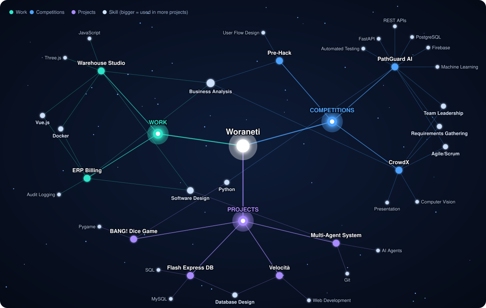

# Woraneti Phicharanan

**Software engineer who turns real business processes into working systems and AI automation.**\
Third-year ICT student, Mahidol University (International Program) · Bangkok, Thailand

I enjoy the step before the code: understanding how a business runs, deciding which work software or AI should take over, then building it.

> [!NOTE]
> **Open to:** Summer 2027 internship (June – July, Bangkok) in software engineering, business analysis or tech / AI consulting.

## Selected work

| Project | What I did | Built with |
|---|---|---|
| **Warehouse Studio** Solo · Benjamin PEB | A 3D tool that lets dealers design a steel warehouse with the customer and send it as a quotation request in minutes. Rebuilt the company's Excel quotation formulas as a server-side pricing engine, so every screen shows the same price. | Three.js, JavaScript, Vue.js, Docker |
| **ERP Platform, billing module** Team of 2 · in development | Milestone billing that always adds up to the contract total, down to the satang, with VAT and rounding in one shared module. Audit-logged document numbering, so every billing document can be traced. | Vue.js, Docker |
| **PathGuard AI** Team lead & backend · National Finalist | Built the backend (37 REST endpoints, 400+ automated tests) and a risk-scoring engine (Isolation Forest, Markov chain, Thai MOPH triage rules) that alerts caregivers within 2 minutes when a person with dementia wanders. | Python, FastAPI, PostgreSQL, Firebase |
| **CrowdX** Team lead · Hackathon award | MUICT x The Mall Hackathon 2026, Team Synergy Award. Counts mall visitors in real time from existing CCTV without storing faces. Gathered requirements from The Mall Group and built the business engine for break-even attendance and cost per visitor. | YOLO, ByteTrack |
| **Multi-Agent Dev System** Personal project | A GPT agent plans and reviews each task, Claude Code agents write the code, and nothing merges without my sign-off. | Claude Code, GPT agents |

## Project & skill map

  

Each project links to the skills it used. Larger skill nodes are used across more projects.

## Tech stack

| Area | Tools |
|---|---|
| **Languages** |  &nbsp;SQL |
| **Backend & data** |  &nbsp;REST APIs |
| **Frontend** |  |
| **Tools** |  |
| **AI tools** | Claude Code, GPT agents |
| **Business** | Requirements gathering, business process analysis, Agile/Scrum |

## Contact

[woraneti2548@gmail.com](mailto:woraneti2548@gmail.com) · [LinkedIn](https://www.linkedin.com/in/woraneti-phicharanan/)
